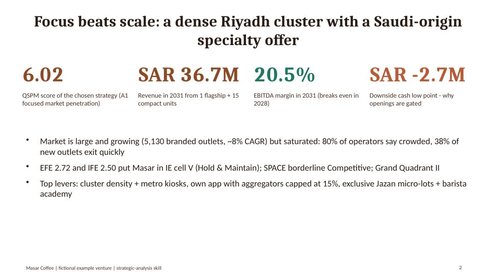
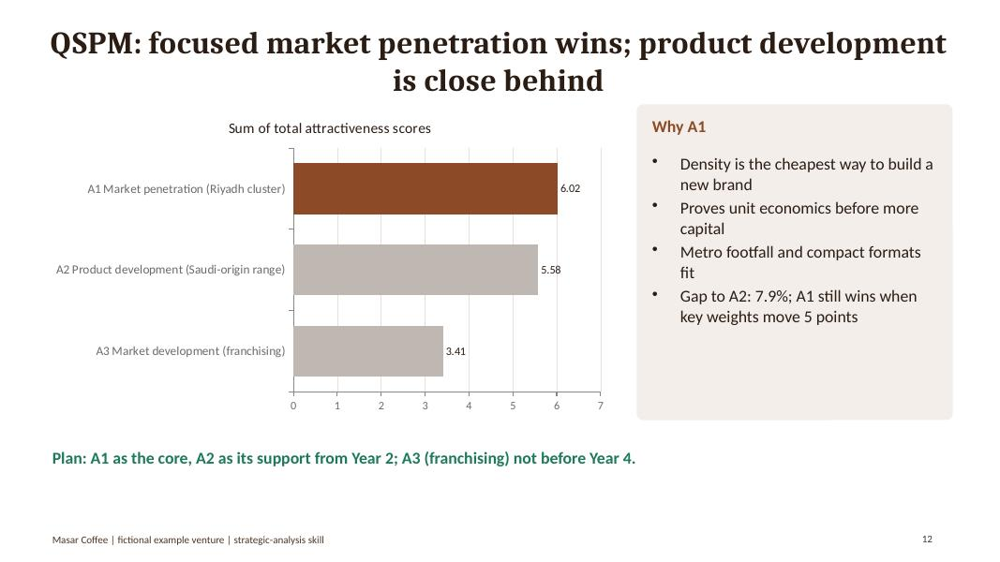
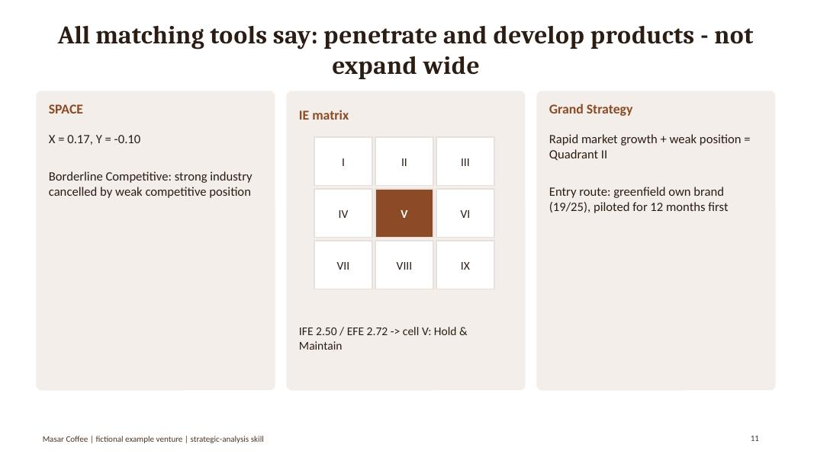
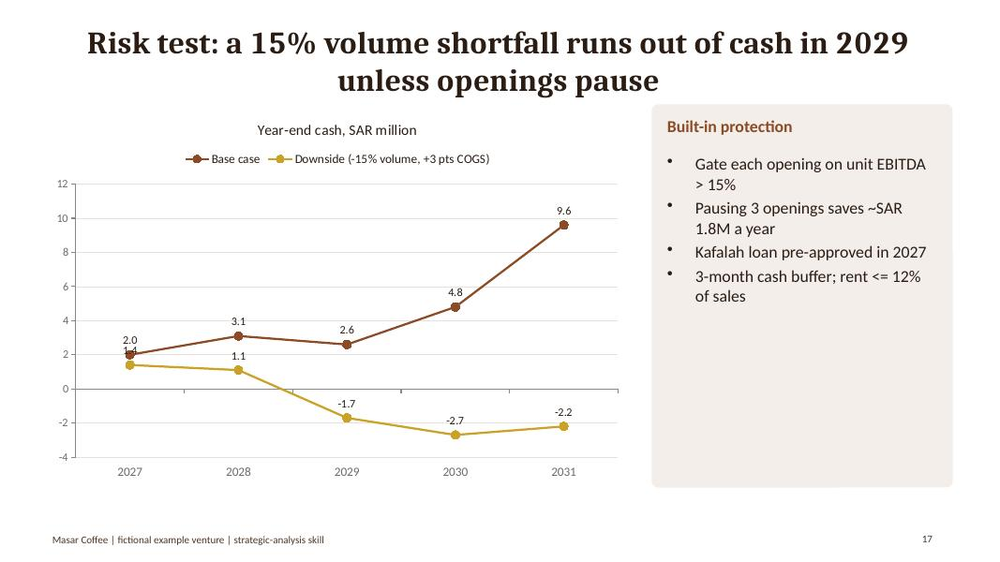
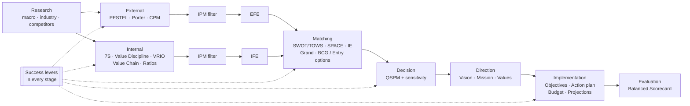

<div align="center">

# Strategic Analysis Skill for Claude

**Turn one sentence into a full, research-backed strategy: an Excel model, a Word report and a summary deck.**

20+ strategy frameworks, chained in the right order, each with solutions that raise the odds of success.

[](LICENSE)
[](https://docs.claude.com/en/docs/agents-and-tools/agent-skills/overview)
[](docs/frameworks.md)
[](CONTRIBUTING.md)

[English](README.md) · [العربية](README.ar.md)

</div>

---

## Why this exists

Most "AI strategy" prompts give you a generic SWOT and stop there. Real strategic management, the kind taught in MBA programs and used by consultants, is a **pipeline**: factors are researched, filtered, weighted, matched, scored and finally turned into a plan with a budget and KPIs.

This skill makes Claude run that whole pipeline:

- **It researches everything itself**: macro data (World Bank, IMF, central banks), industry size and margins, competitors and their financials. You don't paste data.
- **Every framework feeds the next one**, so nothing in the final plan appears from nowhere.
- **No diagnosis without a solution**: every threat, weakness and low score gets a concrete action, with an owner, a cost level, a timeline and the score it improves.
- **Two modes**: analyse an **existing company**, or **build a new venture from scratch** (for a new venture, the vision and mission are written *after* the analysis, based on what it found).

## What you get

| Deliverable | Contents |
|---|---|
| **Excel model** | ~30 linked sheets with live formulas. Change one weight and every downstream score updates. A Solution column on every framework. |
| **Word report** | Full explanation of each framework: purpose, method, results, interpretation, solutions and sources, with a table of contents, captions and references |
| **Summary deck** | About 20 slides, each titled with its main message: position, decision, plan, top 10 success levers, risks. |

## See a full example

**[Masar Coffee: a new specialty coffee chain in Riyadh, built from scratch →](examples/masar-coffee-riyadh/)**
It includes an Excel model (31 sheets, about 1,280 formulas), a 30-page Word report and a 21-slide deck, all generated from a single prompt.

| | |
|---|---|
|  |  |
|  |  |

## The pipeline



## Frameworks included

**Direction**: Vision (7 criteria) and Mission (11 components) evaluation and creation, plus core values
**External**: Industry profile, Competitor landscape, PESTEL (with Hofstede), Porter's Five Forces, CPM, IPM, EFE
**Internal**: McKinsey 7S, Value Discipline Triad, VRIO, Porter Value Chain, 5-year financial statements, ratio analysis, IFE
**Matching**: SWOT, TOWS, SPACE, IE Matrix, Grand Strategy Matrix, BCG, Market-entry options
**Decision**: QSPM with sensitivity check
**Implementation**: SMART objectives, generic strategy, action plan, Gantt, budget, driver-based 5-year projection (break-even, NPV/IRR and funding plan for new ventures), risk register
**Evaluation**: Balanced Scorecard

Scales, formulas and rules for each one are in **[docs/frameworks.md](docs/frameworks.md)**. It works as a standalone cheat sheet too.

## Install

### Claude.ai (web, desktop, mobile)
1. Download **[strategic-analysis.zip](strategic-analysis.zip)** from this repo.
2. Go to **Settings → Capabilities → Skills → Upload skill** and select the zip.
3. Enable it, then ask for an analysis (see prompts below).

### Claude Code
```bash
# personal (all projects)
git clone https://github.com/samy-yusif/strategic-analysis-skill.git
cp -r strategic-analysis-skill/skills/strategic-analysis ~/.claude/skills/

# or project-only
cp -r strategic-analysis-skill/skills/strategic-analysis .claude/skills/
```

### Claude API (Agent Skills)
Upload `skills/strategic-analysis` via the Skills API and attach it to your requests. See the [Agent Skills docs](https://docs.claude.com/en/docs/agents-and-tools/agent-skills/overview).

## Example prompts

```text
Build a full strategic analysis for a new specialty-coffee chain in Riyadh, starting capital ~2M USD.
```
```text
Run a full strategic analysis of Talaat Moustafa Group (Egypt) for 2025. Audited statements attached.
```
```text
I want to launch a B2B SaaS for clinic management in Egypt. Analyse the market from scratch and give me the strategy, vision, mission and a 5-year plan.
```

More in **[examples/prompts.md](examples/prompts.md)**.

## Quality rules built in

The skill checks its own work before it delivers anything:

- Weights in CPM, EFE, IFE and QSPM sum to 1.00
- IFE ratings: strengths 3–4, weaknesses 1–2 (a common mistake in student and consultant work)
- SWOT = exactly the EFE and IFE factors; QSPM reuses the same factors and weights
- SPACE signs and quadrant, and the IE cell, match the computed totals
- Every factor has evidence, a year and a source; old data is flagged
- Objective → action → budget → KPI → scorecard target → projection all link up
- Balance sheets balance; projections are driver-based, not trend-only
- A limitations section states the weak data, the proxies used and what would change the recommendation

## Who it's for

- **Founders**: test an idea against the market before spending money
- **MBA / business students**: a complete, correctly sequenced strategy project
- **Consultants and analysts**: a strong first draft with sources, in hours instead of weeks
- **Corporate strategy teams**: refresh the annual strategy with current data

## Roadmap

- [x] Full example output: [Masar Coffee, Riyadh](examples/masar-coffee-riyadh/) (new venture)
- [ ] Example for an existing listed company (Mode E)
- [ ] Industry packs (real estate, F&B, SaaS, healthcare) with preset key success factors
- [ ] Arabic output option
- [ ] Blue Ocean / Ansoff / Business Model Canvas add-ons

Have an idea? [Open an issue](../../issues/new/choose).

## Contributing

PRs are welcome: new frameworks, industry packs, better rules, translated docs. See [CONTRIBUTING.md](CONTRIBUTING.md).

## License

[MIT](LICENSE). Use it, fork it, build on it.

---

<div align="center">

**If this saved you time, a ⭐ helps others find it.**

</div>
