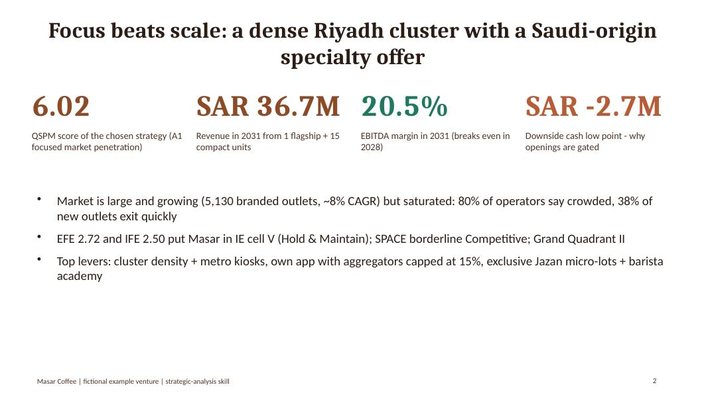
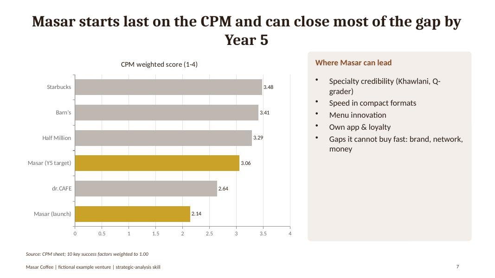
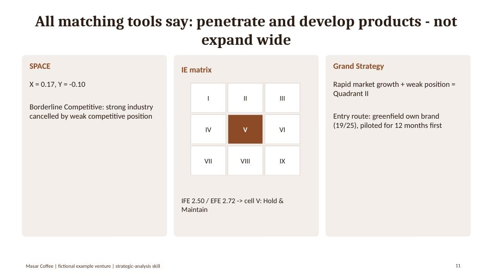
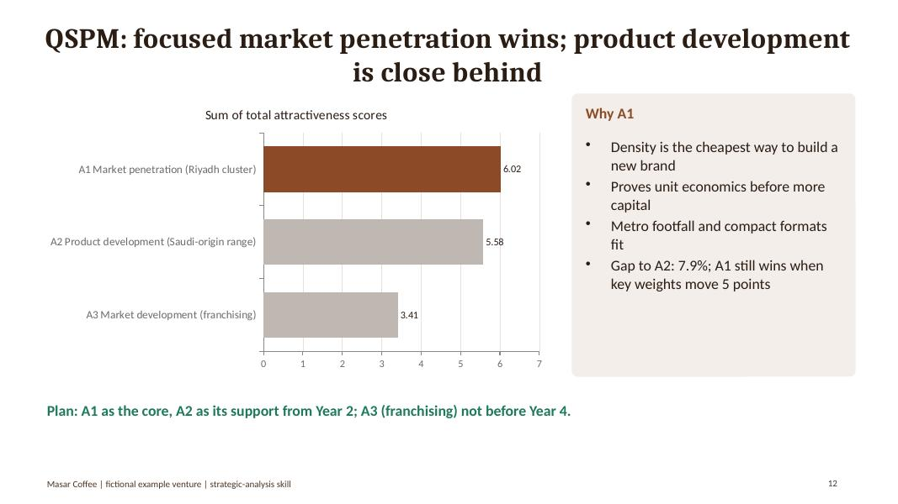
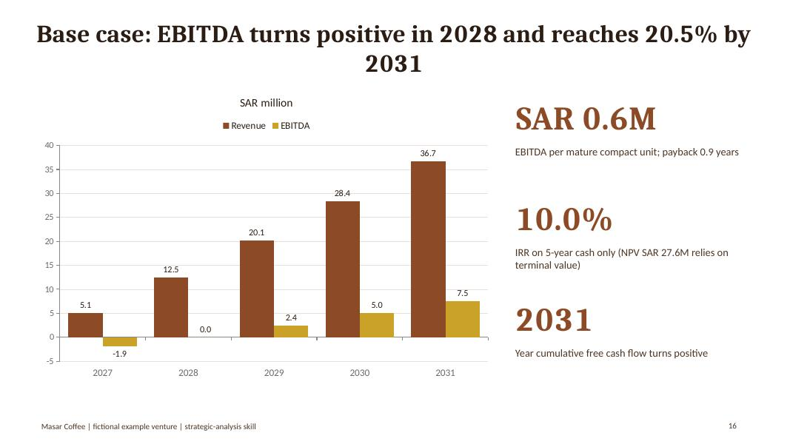
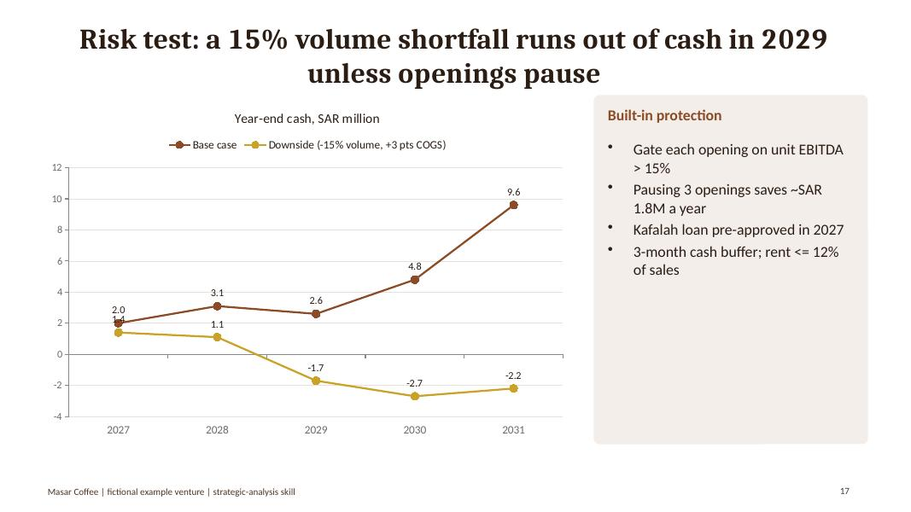
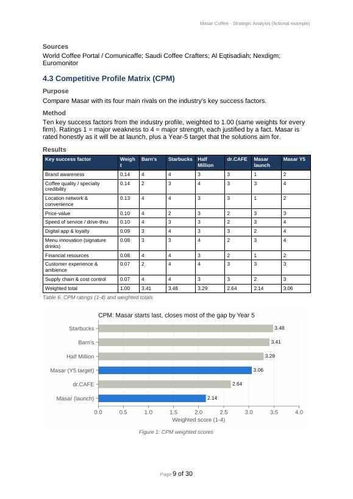

# Example: Masar Coffee, a new specialty coffee chain in Riyadh

A complete run of the skill in **Mode N (new venture built from scratch)**. Masar is a fictional venture; all market, competitor and macro data are real and were researched in November 2026, with sources cited.

**Prompt used:**

```text
Build a full strategic analysis for a new specialty-coffee chain in Riyadh. Capital about SAR 7.5M (~USD 2M),
founders have 10+ years in F&B operations, launch in 2027.
```

## Files

| File | What's inside |
|---|---|
| [Masar_Coffee_Strategic_Analysis.xlsx](Masar_Coffee_Strategic_Analysis.xlsx) | 31 linked sheets, about 1,280 live formulas, zero errors. Switch `Fin Projection!C3` to `2` for the downside case |
| [Masar_Coffee_Strategic_Analysis_Report.docx](Masar_Coffee_Strategic_Analysis_Report.docx) | 30-page report: purpose, method, results, interpretation, solutions and sources for every framework |
| [Masar_Coffee_Summary_Deck.pptx](Masar_Coffee_Summary_Deck.pptx) | 21-slide executive summary with native, editable charts |

## Headline results

| | Result |
|---|---|
| EFE / IFE | 2.72 / 2.50 → IE cell V (Hold & Maintain) |
| SPACE / Grand | Borderline Competitive / Quadrant II |
| QSPM | A1 focused market penetration **6.02** > A2 product development 5.58 > A3 multi-city franchising 3.41 (ranking holds under ±5-point weight tests) |
| Vision (written after the decision) | "To make Saudi-origin specialty coffee the everyday cup for Riyadh's commuters and neighbourhoods by 2032." |
| Base case 2031 | Revenue SAR 36.7M, EBITDA margin 20.5%, EBITDA positive from 2028 |
| Downside (-15% volume, +3 pts COGS) | Cash turns negative in 2029 (low point SAR -2.7M) unless openings pause. This is why each opening is gated on proven unit economics |

## Preview

| | |
|---|---|
|  |  |
|  |  |
|  |  |

Report page sample:



## Honest limitations

- Market-size estimates differ between research houses, so the analysis leans on outlet counts and growth rates.
- Competitors are private. CPM ratings come from disclosed facts plus judgement, and each one is documented.
- The NPV relies heavily on the terminal value. The IRR on five years of cash alone is about 10%, and the report says so.
- Zakat is simplified. Have a Saudi accountant review the plan before raising money.
